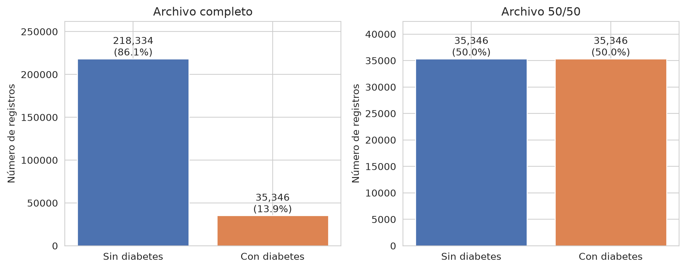
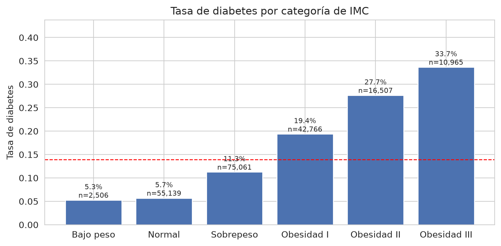
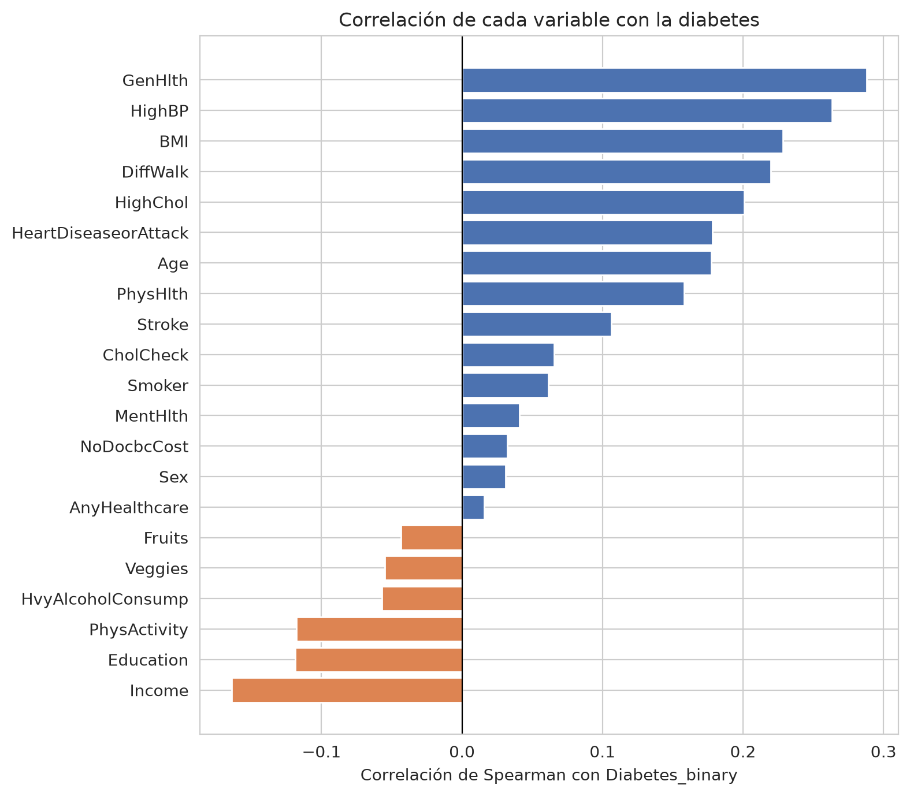

# Prototipo de un sistema de apoyo para la identificación temprana de riesgo de diabetes tipo 2 mediante aprendizaje automático


Prototipo de un sistema de apoyo que estima el nivel de riesgo de diabetes mellitus tipo 2 a partir de datos de salud y estilo de vida, sin necesidad de análisis de laboratorio.

Proyecto de tesis para obtener el título de Ingeniero en Sistemas Computacionales — Universidad Autónoma de Tamaulipas, Unidad Académica Multidisciplinaria Mante-Centro.

---

## Tabla de contenido
- [Contexto](#contexto)
- [Objetivos](#objetivos)
- [Alcance](#alcance)
- [Datos](#datos)
- [Metodología](#metodología)
- [Tecnologías](#tecnologías)
- [Estructura del repositorio](#estructura-del-repositorio)
- [Instalación](#instalación)
- [Uso](#uso)
- [Resultados](#resultados)
- [Estado del proyecto](#estado-del-proyecto)
- [Limitaciones](#limitaciones)
- [Consideraciones éticas](#consideraciones-éticas)
- [Autor](#autor)
- [Referencias](#referencias)

---

## Contexto

La diabetes tipo 2 suele permanecer sin diagnóstico durante años porque sus primeras etapas casi no dan síntomas. Los cuestionarios de riesgo como **FINDRISC** permiten un primer tamizaje sin análisis de sangre, pero usan pocas variables y reglas fijas.

Este proyecto explora si un modelo de aprendizaje automático, entrenado solo con información que una persona puede responder por sí misma (edad, IMC, actividad física, alimentación, etc.), puede estimar el riesgo con un desempeño comparable o superior, y explicar en qué se basa cada estimación.

## Objetivos

**General.** Desarrollar un prototipo que estime el nivel de riesgo de diabetes tipo 2 a partir de variables no invasivas, mediante aprendizaje automático.

**Específicos.**
1. Analizar y preparar el conjunto de datos BRFSS 2015, documentando cada decisión de calidad de datos.
2. Definir conjuntos de variables no invasivas con criterios explícitos y sin fuga de información.
3. Entrenar y comparar modelos de clasificación.
4. Contrastar el desempeño contra una aproximación del cuestionario FINDRISC.
5. Explicar las predicciones del modelo (SHAP) para que sean interpretables.
6. Integrar el modelo en un prototipo de aplicación con formulario.

## Alcance

- Es una herramienta de **apoyo al tamizaje**, no de diagnóstico.
- Usa únicamente variables que la persona puede responder sin laboratorio ni medición clínica.
- Los datos provienen de una encuesta poblacional de Estados Unidos (ver [Limitaciones](#limitaciones)).

## Datos

**Fuente:** *CDC Diabetes Health Indicators*, derivado del Behavioral Risk Factor Surveillance System (**BRFSS 2015**) de los CDC, publicado en Kaggle.

| Archivo | Registros | Uso en el proyecto |
|---|---|---|
| `diabetes_binary_health_indicators_BRFSS2015.csv` | 253,680 · 21 variables + objetivo | **Fuente principal** (conserva la prevalencia real, 13.9 %) |
| `diabetes_binary_5050split_health_indicators_BRFSS2015.csv` | 70,692 (balanceado) | Solo para comparación en el EDA; **no se usa para modelar** porque contiene todos los positivos del archivo completo |
| `diabetes_012_health_indicators_BRFSS2015.csv` | 253,680 · 3 clases | Para verificar la definición de la etiqueta |

**Variable objetivo:** `Diabetes_binary` = diabetes **diagnosticada y autorreportada**. La prediabetes quedó codificada como 0 y la etiqueta no distingue entre tipo 1 y tipo 2.

**Partición:** 80 % entrenamiento (202,944) / 20 % prueba (50,736), estratificada con `random_state=42`, hecha **antes** de explorar relaciones para que la prueba no influya en ninguna decisión.

### Conjuntos de variables (análisis de sensibilidad)

Definidos en [`data/processed/conjuntos_variables.json`](data/processed/conjuntos_variables.json):

| Conjunto | Nº | Variables | Criterio |
|---|---|---|---|
| **Estricto** | 10 | Edad, sexo, escolaridad, ingreso, IMC, tabaquismo, actividad física, frutas, verduras, consumo alto de alcohol | Respondible sin laboratorio, previo al desenlace, no es criterio diagnóstico ni *proxy* de atención médica |
| **Ampliado** | 15 | Estricto + salud general, días de mala salud mental y física, dificultad para caminar, presión alta | Autorreportables pero con posible causalidad inversa |
| **Completo** | 21 | Todas | Referencia |

## Metodología

El trabajo está dividido en cuadernos secuenciales:

| Notebook | Etapa | Estado |
|---|---|---|
| [`01_eda.ipynb`](notebooks/01_eda.ipynb) | Análisis exploratorio, calidad de datos, selección de variables y verificación de fuga de información | ✅ Completo |
| `02_preprocesamineto.ipynb` | Tratamiento de IMC extremo, manejo del desbalance solo en entrenamiento | ⏳ Pendiente |
| `03_modelos.ipynb` | Entrenamiento y comparación de modelos con los tres conjuntos de variables | ⏳ Pendiente |
| `04_findrisc_benchmark.ipynb` | Comparación contra una aproximación de FINDRISC | ⏳ Pendiente |
| `05_explicabilidad.ipynb` | Interpretación de predicciones con SHAP | ⏳ Pendiente |

**Decisiones documentadas en el EDA** (bitácora completa en la sección 11 del notebook 01):

1. Se conservan los **duplicados** (9.5 %): son perfiles sanos plausibles en una encuesta con variables de pocas categorías; quitarlos sesgaría la prevalencia de 13.9 % a 15.3 %. Se comprobó que no inflan el desempeño.
2. Los valores extremos del IMC se tratan en el preprocesamiento, usando solo entrenamiento.
3. El archivo 50/50 se descarta para modelar por **fuga de información**.
4. Se usan **correlaciones de Spearman** y **densidades por clase** por tratarse de variables binarias y ordinales con clases desbalanceadas.

## Tecnologías

- **Lenguaje:** Python 3
- **Análisis:** pandas, NumPy, SciPy
- **Visualización:** Matplotlib, Seaborn
- **Modelado:** scikit-learn, imbalanced-learn, XGBoost, TensorFlow/Keras
- **Explicabilidad:** SHAP
- **Entorno:** Jupyter Notebook

## Estructura del repositorio

```
.
├── app/                     Prototipo de aplicación (en desarrollo)
├── data/
│   ├── interim/             CSV originales de BRFSS 2015 (Kaggle)
│   └── processed/           Particiones de entrenamiento/prueba y conjuntos de variables
├── notebooks/               Cuadernos 01–05 (flujo del proyecto)
├── reports/
│   └── figuras/             Gráficas y tablas generadas por los notebooks
├── src/                     Módulos reutilizables (preprocesamiento, entrenamiento, evaluación, FINDRISC)
└── requirements.txt
```

## Instalación

**Requisitos:** Python 3.12 o superior (desarrollado con Python 3.14).

```bash
git clone https://github.com/EdgarPStder/tesis-diabetes.git
cd tesis-diabetes

python -m venv .venv
# Windows: .venv\Scripts\activate
# Linux/macOS:
source .venv/bin/activate

pip install -r requirements.txt
```

> `requirements.txt` incluye TensorFlow y las bibliotecas de CUDA, por lo que la instalación es pesada. Para reproducir solo el EDA bastan `pandas`, `numpy`, `matplotlib`, `seaborn` y `scikit-learn`.

## Uso

```bash
jupyter notebook notebooks/01_eda.ipynb
```

Ejecuta los notebooks en orden. El notebook 01 lee los CSV de `data/interim/` y genera `data/processed/` y `reports/figuras/`.

## Resultados

Resultados preliminares del análisis exploratorio (sobre el conjunto de entrenamiento):

- **Desbalance:** 13.9 % de casos positivos (35,346 de 253,680 registros).
- **Sin fuga directa:** ninguna variable discrimina por sí sola de forma sospechosa; la más informativa es salud general (AUC univariada ≈ 0.73), seguida de IMC (0.69) y presión alta (0.69).
- **Línea base:** una regresión logística con las 21 variables alcanza **AUC = 0.823** en validación cruzada de 5 particiones, idéntica con particiones agrupadas por perfil, lo que confirma que los duplicados no inflan el desempeño.

| Balance de clases | Tasa de diabetes por IMC |
|---|---|
|  |  |

| Correlación con la variable objetivo |
|---|
|  |

## Estado del proyecto

🚧 **En desarrollo.** El análisis exploratorio está terminado; preprocesamiento, modelado, comparación con FINDRISC, explicabilidad y el prototipo de aplicación están en curso.

## Limitaciones

- **Población:** los datos son de una encuesta de Estados Unidos (2015); el desempeño podría no trasladarse a la población mexicana sin validación adicional.
- **Etiqueta autorreportada:** depende de que la persona haya sido diagnosticada; los casos no diagnosticados aparecen como negativos.
- **Prediabetes** agrupada con la clase negativa, y sin distinción entre tipo 1 y tipo 2.
- **FINDRISC aproximado:** el dataset no incluye perímetro de cintura, antecedentes de glucosa elevada ni antecedentes familiares, por lo que la comparación es una aproximación.
- **Causalidad inversa:** algunas variables (salud general, dificultad para caminar) pueden ser consecuencia de la diabetes; por eso se evalúan tres conjuntos de variables.

## Consideraciones éticas

- El prototipo **no sustituye** una prueba de laboratorio ni el diagnóstico de un profesional de la salud; su resultado debe orientar a la persona a buscar atención médica.
- Los datos utilizados son públicos y anonimizados.

## Autor

**Edgar Gael Pesina Santander** — Ingeniería en Sistemas Computacionales, Universidad Autónoma de Tamaulipas, UAM Mante-Centro.
GitHub: [@EdgarPStder](https://github.com/EdgarPStder)

## Referencias

- Centers for Disease Control and Prevention (CDC). *Behavioral Risk Factor Surveillance System (BRFSS) 2015*. https://www.cdc.gov/brfss/
- Teboul, A. *Diabetes Health Indicators Dataset*. Kaggle. https://www.kaggle.com/datasets/alexteboul/diabetes-health-indicators-dataset
- Lindström, J., & Tuomilehto, J. (2003). The Diabetes Risk Score: A practical tool to predict type 2 diabetes risk. *Diabetes Care, 26*(3), 725–731.
- Lundberg, S. M., & Lee, S.-I. (2017). A unified approach to interpreting model predictions. *Advances in Neural Information Processing Systems, 30*.
